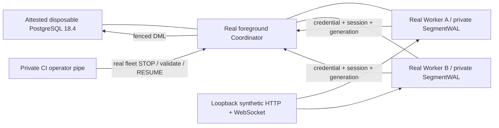

# Isolated first boot acceptance

Status: OFFLINE_VERIFIED / HOSTED_E2E_NOT_RUN. Whole system PARTIAL.
Physical PC4 0/10 NOT_RUN. Execute NOT_AUTHORIZED. Cleanup NOT_AUTHORIZED. Deployment NO-GO.

## Frozen composition

`integration/first_boot_sources.json` records exact source PR heads and selected paths.
The review base is PR238 at 7df22d1c5cdc60bcf4e3414dacd35d23fdec7149.
PR227/230 runtime schema changes are absent from that tree: import their reviewed
runtime/test subset, not complete profile trees. PR229 narrow coverage is superseded
by PR230's DDL workflow. PR239–242 contribute only disjoint profile files.
Original PR branches remain unchanged. Later source-head drift requires a new review.

## Architecture

No SQLite replacement, mocked HTTP, seeded ACTIVE state or mocked PostgreSQL is used
in E2E. Unit fault injection is separate and labelled OFFLINE_UNIT_ONLY.
The audit hook confines normal Python network/file operations; it is not a kernel
sandbox or a defence against malicious native extensions. GitHub disposable runners
and the attested container are the infrastructure boundary. Dependency versions are
frozen directly; transitive dependencies are recorded, not hash-locked.

## Entry points and evidence

`python -m integration.first_boot` is PLAN_ONLY. Execution requires `--execute-ci`,
Linux GitHub-hosted context, exact repository/head/run/attempt/job, local Docker
attestation, owned tmpfs PGDATA, random nonreserved loopback port and matching cluster
identity before SQL. It cannot authorize execution on PC4 or LS5.

Hosted workflow `full-system-first-boot`: four offline OS/Python combinations,
reused native Windows workflow, disposable `pg18`, required aggregate with downloaded
artifact reinspection. All dependencies must conclude success; skipped is rejected.
The exact primary test and subtest inventory is frozen in integration/first_boot_inventory.json; are independently inventoried. E2E has 26
required cases; any missing stage is BLOCKED and fails JUnit. Receipts bind source
SHA256, head/tree, run/attempt, process exits and all evidence bytes. Consistency is
not independent cryptographic provenance. No physical attestation is produced.

## Fault and readiness matrix

| Scenario | Implementation | Current evidence |
|---|---|---|
| Fresh schema, migrations1–48, second preparation | real owner fixture | hosted NOT_RUN |
| App DDL denied / RO DML denied | real distinct roles | hosted NOT_RUN |
| Two concurrent enrollments / replay rejected | real HTTP / private token issuer | hosted NOT_RUN |
| INFRA blocks market and ingest | real runtime gate | hosted NOT_RUN |
| STOP ACK / pilot validation / RESUME ACK | real fleet and workers | hosted NOT_RUN |
| Per-symbol exclusive ownership | real assignments / fencing | hosted NOT_RUN |
| Synthetic WS -> SegmentWAL -> ingest -> candles | real pipeline | hosted NOT_RUN |
| Identical delivery / changed same delivery | immutable receipt boundary | hosted NOT_RUN |
| Worker SIGKILL / new session and heartbeat | owned CI process only | hosted NOT_RUN |
| CONTROL SIGKILL / lease takeover | real election | hosted NOT_RUN |
| PG restart inside same owned container | identity before/after | hosted NOT_RUN |
| Fresh collection after each recovery | new closed minute + LIVE receipts | hosted NOT_RUN |
| Controlled shutdown and resource cleanup | identity-bound children, own root/container | hosted NOT_RUN |
| Worker DB-less heartbeat, endpoint config | unit regressions | LOCAL_PASS |
| Partial provider creation / shutdown pipe failure | explicit unit fault injection | LOCAL_PASS |
| Native handles/ACL/TOCTOU | reused hosted Windows fixtures | hosted pending |
| Physical tokens, source custody, air-gap | not executed | BLOCKED |
| Tailscale/OAuth provisioning / ML training | not faked by this harness | BLOCKED |

Synthetic timestamps and IDs are test-only. Recovery must produce a new canonical
minute and LIVE receipts; existing rows alone cannot prove recovery. Initial partial
ownership minutes may be DEGRADED. Full schema/catalog digest must be unchanged.

## Confirmed fixes and remaining severity

P1: DB-less Worker heartbeat dereferenced `self.db=None`; use actual storage rate.
P1: default reachability ignored configured REST URL; validate and probe configured endpoint.
P2: oversized pytest ID exceeded Windows environment limit; retain payload, bound IDs.
P2: acceptance function omitted expected_heads argument; preserve duplicate-negative test.
P2: publish own container cleanup receipt before fallible inspect, without authorizing SQL.
P2: require fresh cluster proof before cleanup reconnect after PostgreSQL restart.
P2: contain every owned child even when cooperative shutdown pipe fails.
P2: reject stale restart heartbeats and demand new collection after recovery.
P2: pytest9 subtest reports must not inflate primary pass counts.

Remaining P0/P1 deployment blockers: missing independently accepted protected source
and Windows token/custody evidence; existing authorization-boundary reproductions in
`tests/test_pr227_authorization_boundary.py` demonstrate persisted ACTIVE/admin-token
and empty-fleet resume limitations. Their passing tests are defect evidence, not
security acceptance. No physical launch is authorized. Hosted E2E may expose further
runtime integration defects. Do not weaken checks to obtain green CI.

## Future LS5 preflight / PC4 transition

Human authorization is required before any physical observation. First freeze exact
candidate SHA and independently verify a complete downloaded bundle; stop on digest,
identity, ACL/ancestor custody, task, process, schema or role uncertainty. Do not trust
existing ProgramData/Runtime/Fixtures as executable custody. Do not inspect secrets
into logs. Inventory only, no task activation or ACL changes. PC4 requires independently
reviewed protected checkout, dedicated credentials/roles/database, confirmed nonadmin
tokens, observer/STOP separation and approved evidence custody. Air-gap remains unproven.

Rollback of this development work is branch abandonment only; no physical resources
were changed. Hosted failures retain hashed evidence and stop owned children before
owned database removal. Never adopt/delete foreign directories, roles or containers.

Refreshed PR239–242 to latest queried heads before publication; added their new
release-model and independent E2E evidence tests. PR242 SHA regex over-escaped\Z
and rejected all valid digests; four positive-path tests reproduced this, fixed
locally without changing source PR242. All acceptance results remain BLOCKED/NO-GO.
